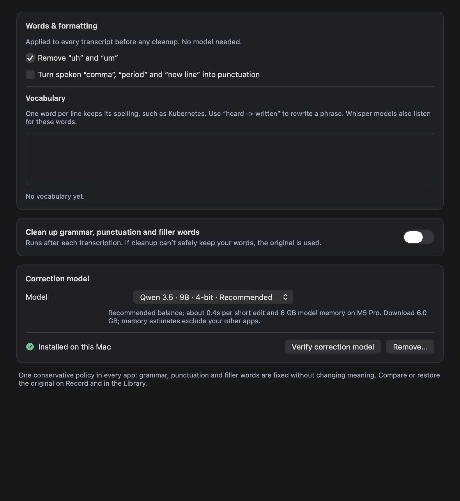
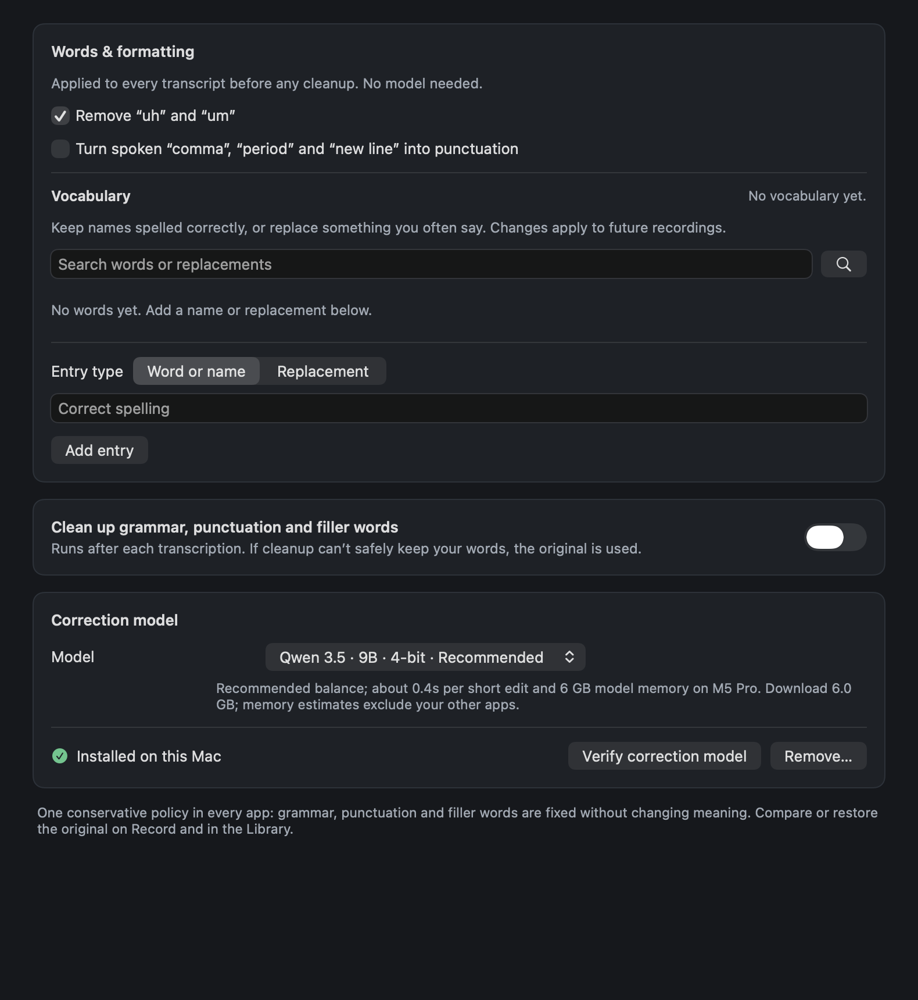
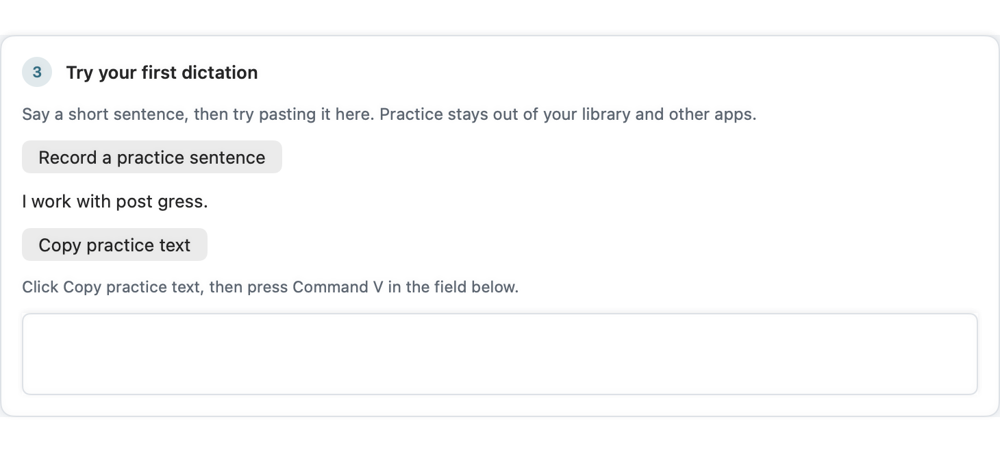
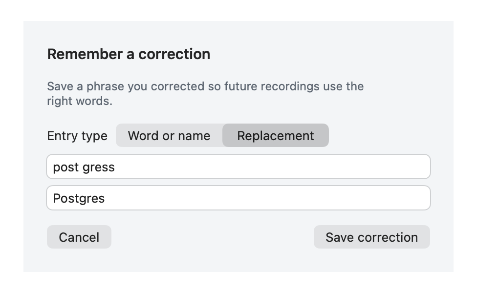

# Daily dictation follow-up

Baseline: `5e01957aea0de3f88ce43cdaa311f382c099877f` on PR #46.

## Behavior

- Smart Paste proceeds independently of history persistence. A completed result
  saves exactly once even when a newer recording starts or the session is
  cancelled. Normal app termination waits for pending writes. Owned capture
  audio is removed promptly after successful recognition; imported files remain.
- Paste confirmation reads immediately instead of always waiting for the first
  40 ms poll. A changed foreground app or focused text field prevents a fallback
  paste. Unreadable fields are still never retried on a guess.
- Advanced & support shows the latest session's monotonic microphone-start,
  processing and Stop-to-delivery measurements and its delivery outcome. These
  values stay in memory and contain no transcript or audio.
- Opt-in Parakeet preview waits one second after each inference instead of two.
  Frame stamps avoid recognizing an unchanged buffer again. Repeated words get
  stable emphasis, with the changing tail subdued and text animations disabled.
  All preview words remain revisable drafts; final delivery still transcribes
  the complete recording. Only one preview inference may be outstanding.
- Models & setup offers a practice recording, input meter, copy action and local
  paste field. Practice has no external destination, writing cleanup, history
  entry or usage count. It never enables shortcuts, Smart Paste or permissions.
- Vocabulary has search, add/edit fields, removal and undo. Comments and unrelated
  entries survive edits; duplicate and stale edits are rejected. Undo cannot
  overwrite subsequent changes. Remember a correction suggests only a short
  changed phrase from the editable transcript, saved only by an explicit action.
- New controls have native keyboard behavior, search/save shortcuts, explicit
  accessibility labels and targeted native status announcements. Timer and live
  draft updates are not continuously announced.

## Validation

- The history delay regression fails against the baseline, then passes after
  delivery is independent of persistence. Two focus regressions produce four
  failed assertions against the old delivery implementation and pass after the
  foreground/field checks. See the retained baseline text files.
- Full `make test`: 3,202 discovered XCTest cases; optional model, visual and
  physical checks may skip. This is not 3,202 hardware acceptance passes.
- CI-pinned SwiftLint 0.65.0 strict lint: zero violations across 497 files.
- Compiler-backed `unused_import` analysis: zero findings across all 20 changed
  source files, using an actual successful Xcode build-for-testing log.
- Strict Python type checking: 11 source files, no issues.
- Native AppKit/SwiftUI view captures were inspected in light and dark appearance.
  Before images retain the previous checkpoint's real writing view. After images
  and the source hash manifest record this iteration. Component images use fixed
  synthetic content and are not proof of physical microphone interaction.

## Cached-model measurement

`model-timings.json` records one cold daemon and two warm trials using the full
production transcription pipeline with cached offline Parakeet v2, audio file
validation, conversion and a clipboard callback. Each complete output matches
the public speech fixture. Cleanup and history were off.

| Trial | File to clipboard callback |
|---|---:|
| Cold daemon | 1,984 ms |
| Warm 1 | 64 ms |
| Warm 2 | 56 ms |

This is a short fixture measurement, not an improvement ratio or a physical
Stop-to-paste latency claim. Hardware capture, OS hotkeys, external application
paste and writing cleanup are excluded. The independently owned daemon is shut
down by test teardown. No model downloads are needed.

Reproduce with the existing cached Python runtime:

```sh
. scripts/lib/xcode-env.sh
ensure_xcode_toolchain
RUN_DICTATION_TIMING=1 \
LIVE_PREVIEW_PYTHON="$HOME/Library/Application Support/AudioWhisper Rebuild/python_project/.venv/bin/python" \
DICTATION_TIMING_OUTPUT=/absolute/output/report.json \
swift test --filter DictationTimingEndToEndTests

DICTATION_CAPTURE_DIR=/absolute/output/native \
swift test --filter DictationFlowVisualTests
```

## Visual comparison

| Previous vocabulary editing | Searchable vocabulary editing |
|---|---|
|  |  |





## Acceptance boundary

The host reports its built-in MacBook Pro microphone and speakers; no AirPods
are connected. Physical AirPods switching, hold-key behavior, sleep/wake and
multi-display Spaces need separate device acceptance. The view renders and
inference fixtures do not certify these paths or complete VoiceOver acceptance.
No TCC database edits or permission changes were made. Public Developer ID
signing, notarization and release distribution remain separate.

The signed debug test bundle built from `0c730b76b876e9c1ad29b9d19baf897376315281`
passed deep, strict signature verification. Its recording diagnostics report the
cached Parakeet v2 model ready and microphone authorization not yet requested.
The user authorized the microphone grant, but native automation could not reach
the macOS permission flow: selecting the app timed out, and Finder actions,
desktop capture and System Settings returned `cgWindowNotFound`. A process sample showed the test app idle
in its normal AppKit event loop, with no observed main-thread hang. No microphone
permission was granted and no live microphone capture was completed. The
preexisting AudioWhisper process and installed application were left in place.
