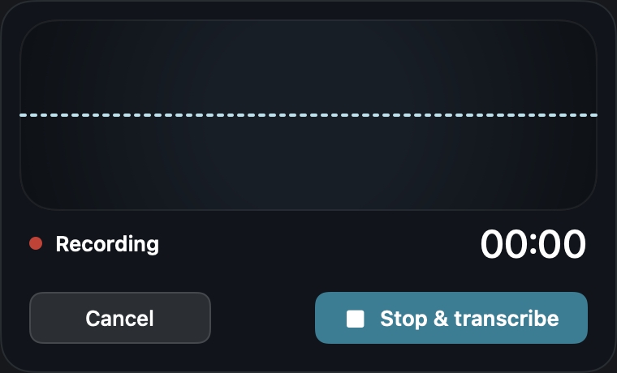
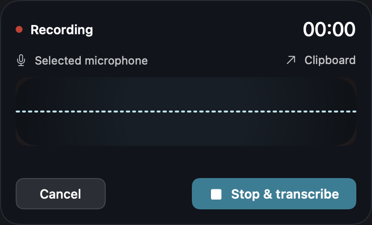
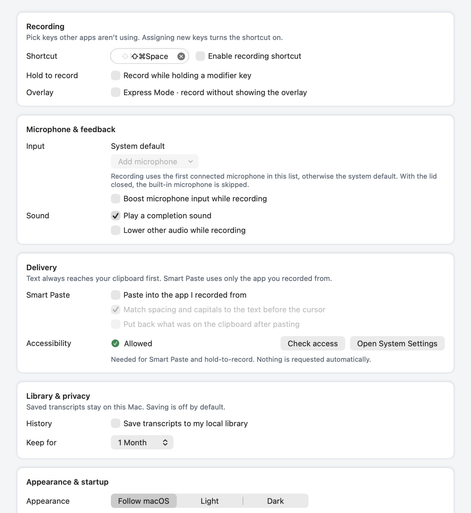
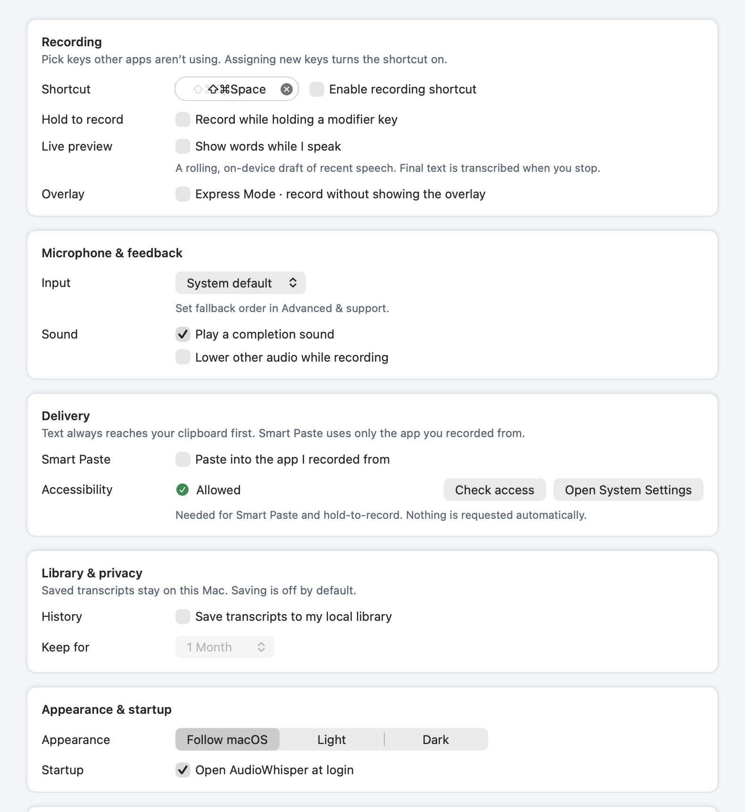
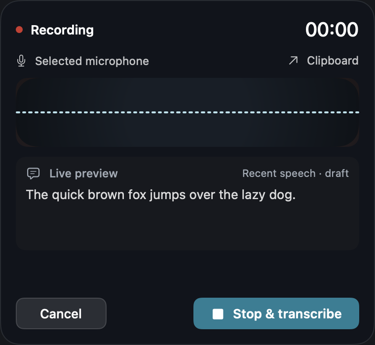

# Recorder, live preview and Preferences polish

Requested items: **3, 7, 12 and 14** from the Superwhisper comparison.
Base: `a80f42f9208bdf98a25d623b15d6397181f52781`.

## Behavior

- The recorder keeps its 380 × 230 frame, with a smaller waveform, readable timer,
  captured microphone name and destination. Opting into preview reserves a fixed
  380 × 350 frame for the entire recording and final-transcription phase.
- Preferences → Recording → **Show words while I speak** enables Parakeet-only,
  on-device rolling drafts. It starts off. A preallocated ring retains at most
  12 seconds, snapshots run off the audio/main threads, and the next recognition
  runs two seconds after the previous inference finishes. Silent/short snapshots
  are skipped. Only one preview inference can be outstanding across replacement
  sessions. Long drafts show their most recent words.
- Preview does not run writing cleanup, copy, paste or save anything. Stop and
  cancellation invalidate its generation. A late result cannot update another
  session; the existing daemon file lease keeps PCM until its reader finishes.
  Preview errors pause the draft while capture and final transcription remain
  available. Stopping still processes the complete capture through the existing
  final-delivery pipeline.
- Everyday Preferences has a simple preferred-microphone picker. Picking another
  microphone promotes it while preserving other fallbacks; choosing System default
  explicitly clears the priority list. Advanced & support holds fallback order,
  boost, cursor matching, clipboard restoration and recorder visual tuning. Stored
  preferences are preserved when their controls move.
- Transcript and library empty/working/recovery states share one component.
  Speech/writing downloads share measured progress styling. Preference failures
  use error tone, and a failed library load no longer claims the library is empty.

## Validation

- Final full `make test` passed: 3,185 discovered XCTest cases; opt-in model,
  visual and physical checks skip and are not represented as hardware proof.
- Final targeted acceptance: 202 cases, three display/opt-in skips, zero failures.
  Includes recorder, routing, Preferences, library, preview ownership and PCM conversion.
- A separately opted-in **real cached Parakeet v2** fixture showed
  “The quick brown fox jumps over the lazy dog.” while the session remained in
  recording state. Nothing was delivered until Stop, then the final transcript
  was delivered exactly once. It used the existing local runtime, an independently
  owned daemon with teardown, synthetic fixture audio and no microphone permission.
  Fixture cadence is shortened for testing; its timing is not product latency.
- Native AppKit/SwiftUI offscreen captures were inspected in light/dark appearance,
  including Advanced, empty/library-off, processing and error states. Before views
  were compiled from the unchanged base source using the same capture harness and
  settings. Temporary baseline view copies were removed after rendering.
- Strict SwiftLint 0.65.1 passed with zero violations. CI pins 0.65.0 separately.
- A host debug app packaged and passed strict local code-signature verification.

`source-sha256.json` binds the principal changed UI/preview sources to these captures.
Reproduce offscreen captures with:

```sh
. scripts/lib/xcode-env.sh
ensure_xcode_toolchain
POLISH_CAPTURE_DIR=/absolute/output/directory swift test --filter RebuildPolishVisualTests
RUN_LIVE_PREVIEW_E2E=1 \
LIVE_PREVIEW_PYTHON="$HOME/Library/Application Support/AudioWhisper Rebuild/python_project/.venv/bin/python" \
swift test --filter LivePreviewEndToEndTests
```

## Sonar follow-up

The initial gate passed at 93.2% coverage on new code. Four maintainability
findings were addressed by extracting nested conditionals, documenting the
recorder-free preview default, and moving TaskLocal propagation into a helper
with at most two nested closures. Recorder/setup, capture configuration, preview
ownership and delivery integration checks passed: 31 cases, zero failures.
Strict lint and the native capture run also passed after this refactor.

## Analyzer follow-up

CI identified the preview audio file's unused `AVFoundation` umbrella import.
It now imports `AVFAudio`, which defines the audio file, format and buffer types
used by PCM conversion. With CI's pinned SwiftLint 0.65.0, compiler-backed
`unused_import` analysis of that file reports zero findings and strict lint
reports zero violations across 481 files. The Xcode test build and all eight
preview/audio tests pass. This import-only change leaves the captured views
unchanged; the source hash manifest includes the corrected import.

## Visual comparison

| Before | After |
|---|---|
|  |  |
|  |  |



## Acceptance boundary

These are native **view renders and synthetic audio inference**, not a physical
microphone/hold-key, hotplug, Spaces or sleep/wake run. No TCC settings were changed.
The preview is a periodically refreshed window of recent speech, not a committed
word-by-word streaming transcript. The debug signature is not Developer ID or
notarization. Public distribution and physical acceptance remain separate.
